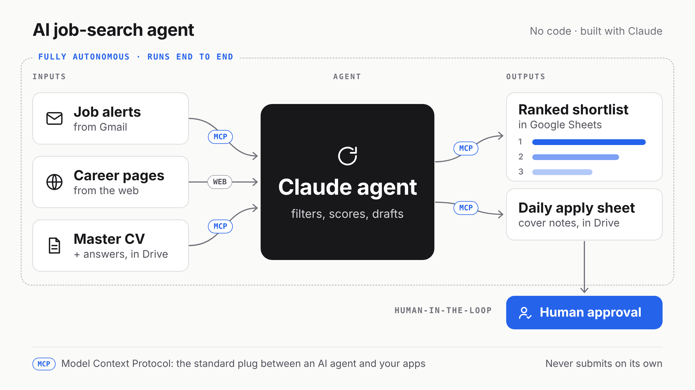

# AI Job-Search Agent

An agentic AI workflow that runs a job search end to end. It pulls job alerts, searches company career pages, filters and scores each role against a master CV, and prepares a daily apply sheet for the strongest matches. A human reviews everything before anything is submitted.

Built with Claude, without writing a single line of code.

## How it works

The agent runs as a scheduled Claude task every weekday morning. Each run goes end to end with no one watching:

1. **Pull** new job alerts from Gmail
2. **Search** company career pages for open roles
3. **Filter** by role type, level, years of experience and location
4. **Score** each remaining role from 0 to 100 against a master CV
5. **Draft** a daily apply sheet for the top 5 roles: a cover note, screening answers and a referral message for each, plus a flag when a role is strong enough to deserve a tailored CV
6. **Log** every scored role to a tracker, with its source, fit score and notes

A second scheduled task drafts follow-up messages a week after an application goes out. It never sends them.

## Stack

| Part | What it does | How it connects |
|---|---|---|
| Claude scheduled task | Runs the agent on a fixed schedule | Built-in |
| Gmail | Source of job alerts | MCP connector |
| Google Drive | Holds the master CV and an answer bank, receives the daily apply sheet | MCP connector |
| Google Sheets | The tracker | MCP connector |
| Web search | Finds and opens live career pages | Built-in |

MCP (Model Context Protocol) is the standard way an AI agent plugs into apps.

## Design choices

- **Human-in-the-loop.** The agent prepares everything and decides nothing. It never applies, sends an email, contacts anyone or creates an account.
- **No invented content.** Drafts use only facts from the master CV and a bank of standard answers. The agent never adds experience, numbers, clients or links that it did not find.
- **Fresh, live roles only.** It focuses on roles posted in the last 24 hours (72 on Mondays, to cover the weekend), opens every listing it can reach to confirm it is still live, and skips closed postings.
- **No duplicates.** Before logging, it checks the tracker and merges roles found in both Gmail and the web.
- **It checks its own work.** After writing to the tracker, it reads the rows back to confirm every column is filled.
- **Read-only on existing files.** It never edits or deletes anything it did not create.

## Results

Each run ends with a ranked shortlist of every qualifying role and a daily apply sheet for the strongest matches. The agent is designed to prepare up to 5 applications per run, so at 5 runs a week it can prepare up to 25 applications a week, each one waiting for human approval.

## What I ran into

- **Big names crowded out the rest.** One broad search returned mostly large firms. Splitting the search into separate groups fixed it.
- **Some listings need a login.** When a listing page could not be opened, the agent scored the role from the alert email text and flagged it in the tracker.
- **Not every posting has a date.** The agent notes in the tracker how it dated each role, or marks it "undated".

## Tracker template

[`templates/tracker-template.csv`](templates/tracker-template.csv) has the tracker columns, ready to import into Google Sheets.

## About the prompt

The agent's full instructions are kept private. This repo documents the design, the architecture and the results.

## Status

Built in October 2026.

## Author

Vidhisha Jain · [LinkedIn](https://www.linkedin.com/in/vidhishajain1805)
